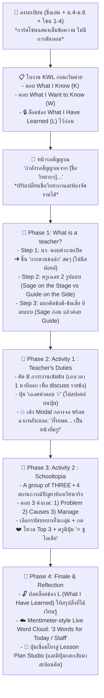

# 🎒 The Teaching Profession Workshop (วิชาชีพครู)

> **เว็บแอปพลิเคชันห้องเรียนแบบโต้ตอบ (Interactive Classroom SPA) • React 18 + Tailwind CSS**  
> รองรับทั้ง **Local Multi-Tab Sync (ด้วย `localStorage` + `storage event`)** และการจัดห้องกิจกรรมแยกตามรุ่น/วัน

---

## 🌟 จุดเด่นและระบบที่อัปเกรดล่าสุด (Version 2.0 Highlights)

---

## 📋 สรุปการแก้ไขตามข้อเสนอแนะ 11 ประการ

1. **เอาโปสเตอร์ออก:** ลบ Modal และปุ่มโปสเตอร์ออก เพื่อให้หน้าเว็บเรียบหรู สะอาดตา โฟกัสกับกิจกรรมและการเรียนรู้
2. **ใบงาน KWL บังคับทำก่อนเริ่ม Workshop:**
   - เมื่อเด็กกรอกชื่อและเลือกโซนเสร็จ จะเข้าสู่ **หน้าต่างทำใบงาน KWL ทันที**
   - ตอบช่อง **K: What I Know** และ **W: What I Want to Know**
   - ช่อง **L: What I Have Learned** ถูก **ล็อคไว้ 🔒** พร้อมป้ายบอกว่าจะปลดล็อคให้สรุปท้ายค่าย
3. **การแบ่งโซนอ่านได้ครบถ้วน:**
   - แก้ไขการ์ดเลือกโซน 1-4 ไม่มีการใช้ `...` ตัดทอนคำบรรยาย แสดงชื่อสถานการณ์ชัดเจน สบายตาบนทุกขนาดหน้าจอ
4. **ระบบสร้างห้องแยกตามวัน & ปรับเปลี่ยนชื่อวิทยากรได้:**
   - หน้ารอขึ้นว่า: **"กำลังรอสัญญาณจาก [ชื่อวิทยากร]..."**
   - แอดมินสามารถคลิกแก้ชื่อวิทยากร (เช่น "พี่สกาย", "อ.สมชาย", "พี่เนย") ได้ทันที
   - มีระบบ **"🚪 จัดการห้อง"** สามารถสร้างห้องกิจกรรมใหม่แยกตามวัน/รุ่น (มีรหัสห้อง เช่น `EDU69`) ข้อมูลแต่ละรุ่นจะไม่ทับกัน
5. **กิจกรรมที่ 1 (What is a teacher?) ปรับลำดับขั้นตอนการสอน:**
   - **Step 1:** นร. ตอบคำถามเปิด *"ในมุมมองของน้องๆ ครูคืออะไร?"* ➔ ข้อความจะเด้งขึ้นบน **Classroom Chalkboard (กระดานชอล์กสีเขียวสไตล์ห้องเรียนจริง)** ยังไม่มีการสปอยล์ Sage หรือ Guide และไม่มีปุ่มข้อดี/ข้อเสีย
   - **Step 2:** แอดมินกดเปิดตัวเฉลย 2 บทบาท: *Sage on the Stage (ปราชญ์บนเวที)* และ *Guide on the Side (ผู้ชี้แนะเคียงข้าง)*
   - **Step 3:** ชวนคิดข้อดี-ข้อเสียทีละแบบ: แอดมินเปิดให้คิดแบบที่ 1 (Sage) ก่อน ➔ แล้วค่อยสลับไปแบบที่ 2 (Guide)
6. **Activity 1 : Teacher's Duties:**
   - เอาการจำกัดเวลา 1 นาทีออก
   - คัดเลือก **8 ภาระงานสำคัญ** จาก 24 ข้อ เพื่อให้ครูและเด็กได้ discuss ทีละข้ออย่างลึกซึ้ง
   - ปุ่มเฉลยเขียนเรียบง่ายว่า **"เฉลยคำตอบ 💡"** (ไม่สปอยล์บนปุ่ม)
   - เมื่อกดเฉลย: จะเด้ง **Pop-up Modal ตรงกลางหน้าจอ พร้อมฉากหลังเบลอ (Backdrop Blur)** บอกว่า *"ทั้งหมด... เป็นหน้าที่ของครูในชีวิตจริง! 😱🎓"*
7. **Activity 2 : Schooltopia:**
   - คงกติกา A group of THREE พร้อม 3 คำถามหลัก (Problem, Causes, Manage)
   - เพิ่มปุ่มเลือกบทบาทในกลุ่ม (🎯 สังเกตการณ์ / ✍️ ผู้บันทึก / 🎤 ตัวแทนพูด)
   - มีปุ่ม **"⭐ ชูไอเดีย"** ให้ครูเลือกไอเดียเด่นฉายเด่นขึ้นจอ
8. **คำถามเรื่อง Firebase:**
   - **โหมดทดสอบ / แท็บบนเครื่องเดียวกัน:** ใช้ `localStorage` + `storage event` ได้ทันที 100% ไม่ต้องต่อเน็ต ไม่ต้องเซ็ต Database
   - **โหมดใช้งานจริงในห้องเรียนที่มีเด็ก 30-50 คนใช้มือถือของตัวเอง:** จะต้องเชื่อมต่อกับ **Firebase Cloud Firestore** (หรือ Backend WebSocket) เพื่อให้มือถือทุกเครื่องซิงค์ข้อมูลข้ามเครือข่ายอินเทอร์เน็ตได้
9. **Responsive UI:** ปรับขนาดตัวอักษรและระยะขอบให้สวยงามบนมือถือทุกรุ่น แท็บเล็ต และจอโปรเจกเตอร์
10. **การสะท้อนคิดหลังทำ Lesson Plan:**
    - ใน `lesson-plan.html` เพิ่มปุ่ม **"🔙 กลับสู่ Workshop (สรุป KWL)"**
    - เมื่อกลับมา Phase 4 ช่อง **L: What I Have Learned** จะ **ปลดล็อค 🔓** ให้เด็กสรุปสิ่งที่ได้เรียนรู้ในค่ายเทียบกับสิ่งที่เคยตอบในช่อง K และ W
11. **Mentimeter-style Live Word Cloud (เมฆคำศัพท์สด):**
    - นักเรียนพิมพ์ **3 คำ** (เช่น 3 คำให้ค่ายวันนี้ หรือ 3 คำถึงพี่ๆ Staff)
    - จอแอดมิน/โปรเจกเตอร์แสดง **Live Word Cloud** คำที่ซ้ำกันจะขยายใหญ่ขึ้นอัตโนมัติแบบเรียลไทม์!

---

## 💻 วิธีการเปิดทดสอบ

1. **เปิดไฟล์ตรง:** ดับเบิลคลิก [`index.html`](file:///d:/SKY/Workshop%20EDU/index.html) ในเบราว์เซอร์ (Student View) แล้วกดปุ่ม `💻 แท็บ Admin` เพื่อเปิดหน้าควบคุม
2. **เปิดผ่าน Server:** ดับเบิลคลิก [`run.bat`](file:///d:/SKY/Workshop%20EDU/run.bat) ระบบจะเปิด `http://localhost:8080/` ให้อัตโนมัติครับ
